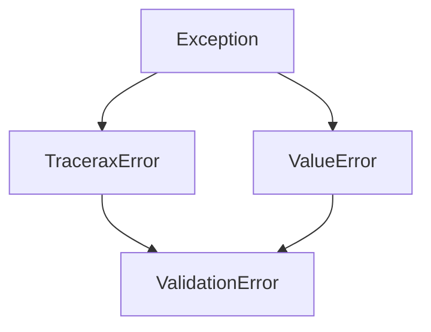

# Exceptions

Every error raised by the package derives from [`TraceraxError`][tracerax.TraceraxError], and from the closest standard-library exception, so a caller who knows nothing of the package still catches it.

::: tracerax.exceptions
